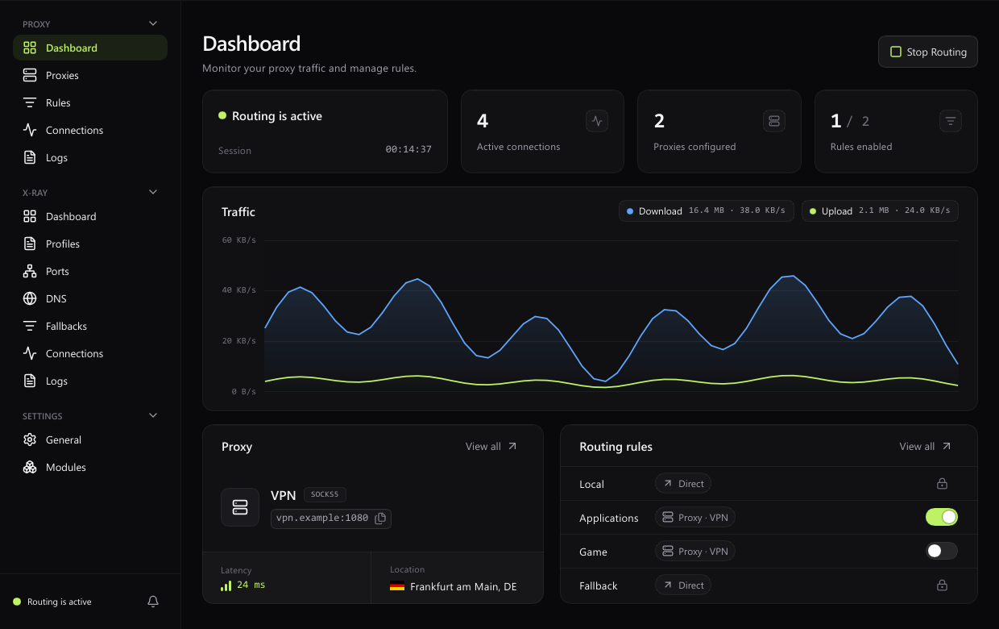

# True Proxy

[Русский](README.md) · **English**

Route TCP and UDP traffic from individual Windows apps through SOCKS5. Send your browser, games, and work apps through different proxies and manage their routes from one window.

**[Download for Windows x64](https://github.com/duoxik/true-proxy/releases/latest)** · [What's new](RELEASE_NOTES.md) · [User guide (Russian)](docs/guide.md)

*The proxy address, location, and traffic shown here are sample data.*

## Quick start

1. Download and extract `TrueProxy-windows-x64.zip`, then run `TrueProxy.exe`. Windows asks for administrator privileges to intercept traffic.
2. In **Proxy → Proxies**, add a SOCKS5 server and click **Test**. UDP requires a server that supports `UDP ASSOCIATE`.
3. In **Proxy → Rules**, create a rule for an app and select its proxy. Check **Fallback** to choose how unmatched traffic is routed.
4. On **Dashboard**, click **Start Routing** if routing is paused. Closing the window keeps True Proxy in the system tray. Choose **Exit** from the tray menu to stop interception.

When you edit rules while routing is active, **Restart** applies the changes and closes existing proxy connections.

## Tabs

### Proxy

| Tab | What it does |
| --- | --- |
| **Dashboard** | Toggle routing and see the session timer, traffic rates, and traffic history. |
| **Proxies** | Manage SOCKS5 servers and credentials, and check availability and latency. |
| **Rules** | Order rules and choose Proxy, Direct, or Block based on the process, domain, IP, port, and protocol. |
| **Connections** | Inspect connections by app, their routes and traffic totals, and filter the list. |
| **Logs** | Pause, clear, and copy diagnostic logs. |

### Optional X-Ray module

Install **Xray-core** in **Settings → Modules** to open the **X-RAY** section. The module runs local SOCKS5 listeners for VLESS profiles. Add a local port in **Proxies** to use it in True Proxy rules. [X-Ray setup (Russian)](docs/guide.md#дополнительный-модуль-x-ray).

| Tab | What it does |
| --- | --- |
| **Dashboard** | Start Xray-core and see its status, events, and local SOCKS5 ports. |
| **Profiles** | Import VLESS profiles and subscriptions, and choose an active profile for each port. |
| **Ports** | Configure the names and numbers of local SOCKS5 ports. |
| **DNS** | Configure resolvers for domain names sent to Xray's SOCKS5 ports and see VLESS server addresses. |
| **Fallbacks** | Set up direct routing by GeoIP and GeoSite. |
| **Connections** | View events for requests accepted by Xray-core. |
| **Logs** | View Xray-core's diagnostic logs. |

### Settings

| Tab | What it does |
| --- | --- |
| **General** | Import or export configuration, choose a theme and surface effects, and manage startup and updates. |
| **Modules** | Install and update Xray-core and hpwnr for encrypted subscriptions. |

## What to know

- **Routing.** Local network traffic goes direct. Other traffic follows the first matching rule, with **Fallback** for unmatched traffic. Domain rules depend on observed DNS responses.
- **DNS.** Windows handles standard DNS queries. DoH and DoT connections follow the app's routing rules.
- **Configuration.** Windows protects SOCKS5 passwords in the local profile. JSON exports include them in plaintext.
- **Status.** WinDivert interception is experimental. End-to-end testing for TCP, UDP, IPv6, and VPN compatibility is still pending. [Known limitations (Russian)](docs/guide.md#ограничения).

## Development

Rust · Slint · WinDivert. Use `scripts/bootstrap.ps1` and `scripts/dev.ps1` for local builds. [Build and test commands (Russian)](docs/guide.md#разработка-и-проверка).

[Third-party notices](THIRD_PARTY_NOTICES.md)
