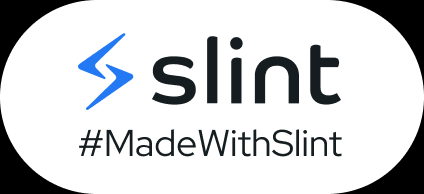
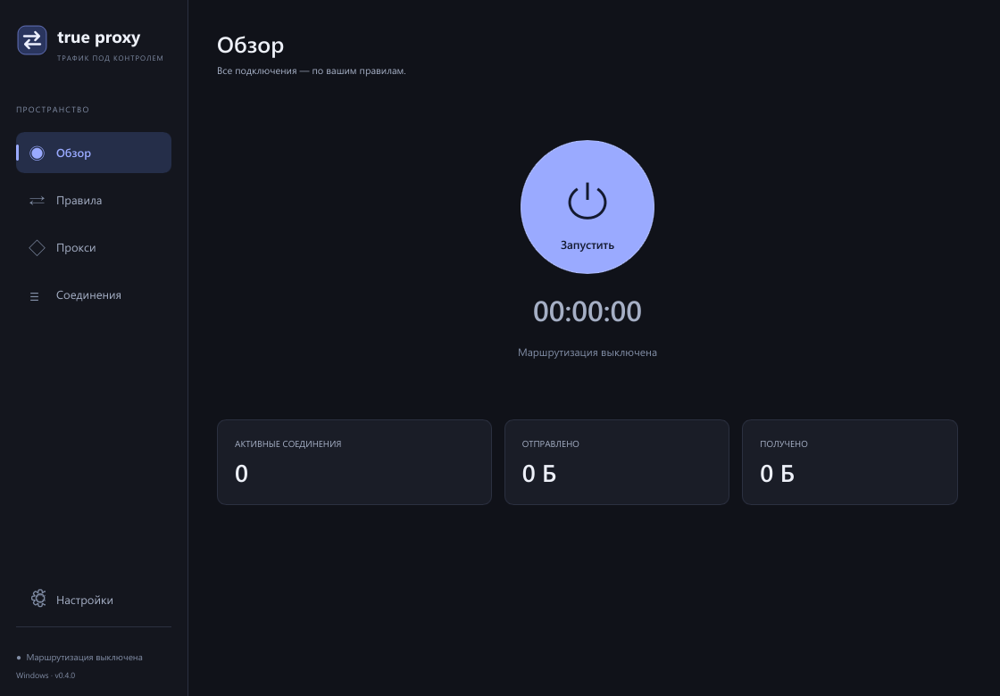
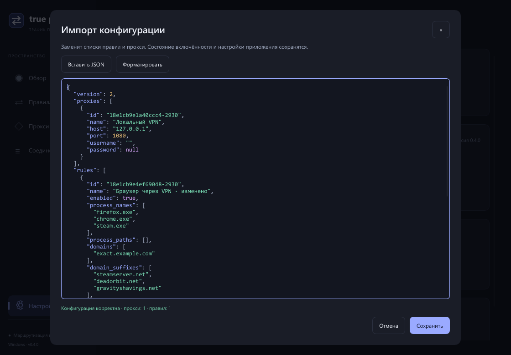
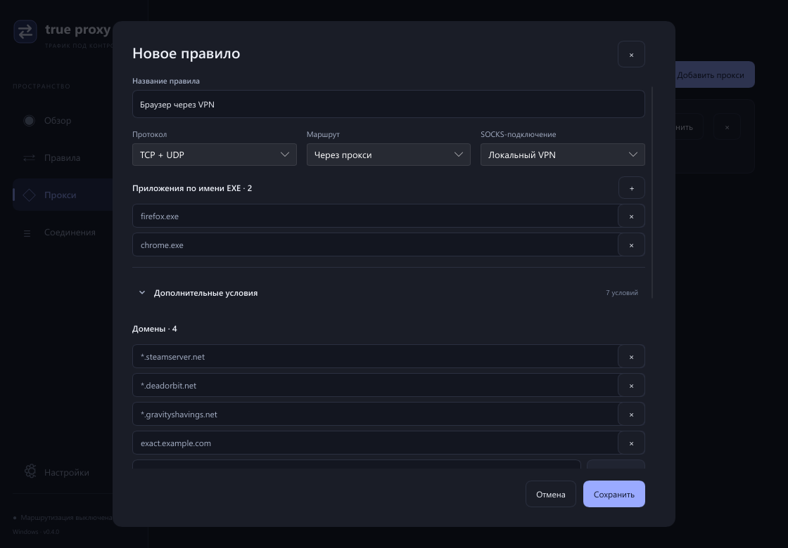
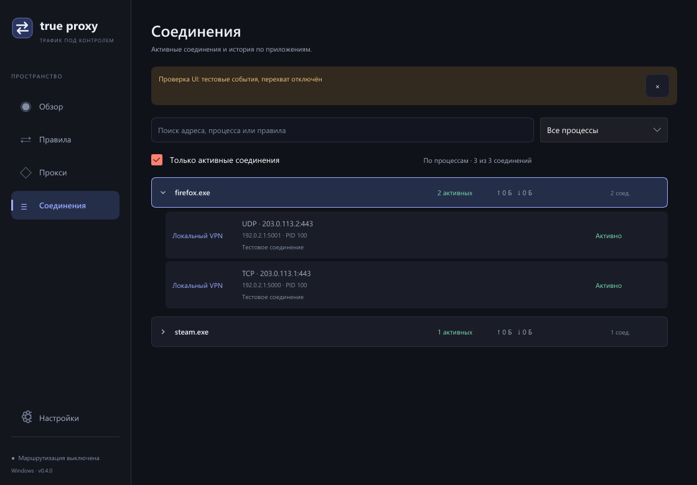

# True Proxy

Легковесное Windows-приложение для маршрутизации TCP/UDP отдельных приложений
через SOCKS5. Rust, нативный Slint с программным рендерингом, WinDivert 2.2.2.
Без Electron, браузера и WebView. Имена разрешает системный DNS Windows.

[Скачать последнюю версию](https://github.com/duoxik/true-proxy/releases/latest)

[](https://slint.dev)



## Состояние

Экспериментальная реализация. Конфигурация, правила, SOCKS5 TCP/UDP, учет
трафика, выбор процессов и интерфейс проверяются без перехвата пользовательской
сети. Backend WinDivert реализован, но сквозная работа перехвата TCP/UDP/IPv6,
отказ прокси, остановка драйвера и взаимодействие с VPN требуют изолированных
интеграционных тестов. Совместимость с Destiny 2 и ее античитом не подтверждена.

По решению пользователя DNS по приложениям отложен. Fake-IP не входит в продукт;
прототип сохранен в [архиве исследования](docs/dns-per-application.md).

## Запуск

1. Распакуйте ZIP из `dist` и откройте `TrueProxy.exe`. WinDivert встроен в EXE:
   рядом не нужны его DLL/SYS. При включении они атомарно извлекаются в
   `%LOCALAPPDATA%\TrueProxy\runtime\WinDivert-2.2.2-A-x64`, без скачивания.
2. Добавьте SOCKS5-подключение, например `127.0.0.1:1080`. В форме можно проверить
   введенные данные до сохранения. Список автоматически проверяется при запуске
   и раз в 30 секунд, в том числе в трее, максимум четыре проверки одновременно.
   Зеленый/красный статус показывает TCP и отдельно UDP. «Проверить» выполняет
   handshake и отдельно проверяет принятие `UDP ASSOCIATE`. Это еще не доказывает
   доставку датаграмм до внешнего узла.
3. Создайте правило. Нажмите «+» → «Из запущенных процессов», отметьте приложения и добавьте их в список.
   По умолчанию сохраняются имена EXE; можно выбрать полные пути. PID не сохраняются,
   поэтому правило действует после перезапуска приложения. Список обновляется
   по запросу, без фонового опроса процессов.
4. Выберите TCP + UDP и нужный SOCKS. Для всего трафика игры оставьте домены,
   IP и порты без ограничений. Процессы игры и лаунчера — отдельные значения.
   Несовпавший трафик по умолчанию идет напрямую; это меняется в последнем блоке «Маршрут по умолчанию» на странице правил.
5. При обычном запуске Windows автоматически запросит права администратора через
   UAC. Отдельной кнопки повышения прав в настройках нет. Программа восстанавливает
   последнее состояние маршрутизации: ручная пауза сохраняется после полного выхода.
6. В настройках можно включить автозапуск при входе в Windows. Создается
   задача Планировщика для текущего пользователя с повышенными правами и запуском
   в трей (`--tray`). Сохраненная пауза сохраняется; удаление галочки удаляет
   только эту задачу. При переносе EXE отключите и включите автозапуск заново.
7. Правила, SOCKS-подключения и маршрут по умолчанию можно сохранять при работающем прокси.
   В окне «Конфигурация сохранена» выберите «Применить позже» или «Перезапустить прокси».
   При отсрочке действуют прежние правила, а оранжевое уведомление напоминает
   о сохранённых изменениях. Они применятся при следующем запуске маршрутизации.
   Перезапуск по кнопке временно останавливает перехват и закрывает текущие
   прокси-соединения; автоматического перезапуска при сохранении нет.
8. В настройках «Экспортировать» копирует переносимый JSON в буфер обмена вместе
   с паролями SOCKS. «Импортировать» открывает редактор с подсветкой синтаксиса,
   вставкой JSON и форматированием. Перед сохранением проверяются структура,
   версия 2, значения, уникальность ID и ссылки правил на прокси. Максимум — 2 МиБ.
   Импорт заменяет правила, прокси и маршрут по умолчанию; состояние включённости,
   автозапуск и обновления сохраняются. Пароли в локальном профиле защищаются DPAPI.



Не направляйте транспорт VPN в его собственный SOCKS-порт. При общем маршруте
через SOCKS добавьте более приоритетное прямое правило для процессов VPN.

Обычный запуск восстанавливает сохраненное состояние при наличии прокси.
Ручное включение/пауза записываются сразу; подтвержденный отказ запуска или
завершение backend запоминаются как выключенное состояние. Для запуска с паузой:

```powershell
.\dist\TrueProxy\TrueProxy.exe --paused
```

На главной странице большая кнопка запуска/остановки и таймер подтвержденной
работы сетевого слоя. Таймер учитывает время в трее и сбрасывается при остановке.
Крестик окна сворачивает приложение в трей. Значок различает работу, паузу
и ошибку: логотип с зеленой точкой означает подтвержденную работу, с красной —
выключение или ошибку; причина видна в tooltip и UI. «Выход» останавливает
перехват и закрывает сетевые ресурсы, сохраняя выбранное состояние для следующего запуска.
Повторный запуск EXE открывает окно работающего экземпляра, включая запуск
из трея, без создания второго сетевого слоя. Значок повторно регистрируется,
если при входе в Windows Проводник еще не готов, и восстанавливается после его
перезапуска. После успешной регистрации таймер восстановления отключается.
В Windows используется собственный небольшой модуль `src/platform/windows/tray.rs`.

Настройки: `%LOCALAPPDATA%\TrueProxy\config.json`. Запись атомарная, пароли
защищены Windows DPAPI для текущей учетной записи; перенос JSON в другую учетную
запись не переносит доступ к паролям. Поврежденный профиль не перезаписывается.

## Правила и домены



- Первое включенное совпавшее правило определяет действие: SOCKS, напрямую
  или блокировка. Порядок меняется стрелками.
- Правила включаются тумблером прямо в списке. Фиксированный последний блок
  задает действие для несовпавшего трафика; удалить или переместить его нельзя.
- Домены, IP/CIDR и порты находятся в раскрываемых дополнительных условиях.
  Сворачивание скрывает поля, сохраняя их значения и действие.
- Значения одного списка объединяются через ИЛИ, разные виды условий — через И.
  Например, процесс + домен ограничивает трафик этого процесса указанными доменами.
- Условия: имя EXE, полный путь, TCP/UDP, IP/CIDR, домены, порты и их диапазоны.
  Значения можно добавлять и удалять отдельными строками. Введенное перед
  нажатием «Сохранить» значение также попадает в список.
- `example.com` — точное имя; `*.example.com` включает сам домен и его поддомены.
  Звездочку пользователь вводит явно; отдельной галочки поддоменов нет.
- Используемый в правилах или маршруте по умолчанию прокси нельзя удалить,
  пока не разрешены зависимости. Ошибка SOCKS не включает прямой fallback.

По запросу пользователя при первом запуске этой версии домены существующих
маршрутов профиля версии 1 переводятся в `*.`. Исходный профиль сохраняется
рядом как `config.v1-backup-N.json`, обновленный профиль атомарно записывается
с версией 2. Новые точные имена версии 2 автоматически не расширяются.
Предыдущие версии приложения не читают профиль версии 2; для отката есть копия.

Доменные правила используют ограниченный TTL-кэш DNS-ответов, наблюдаемых после
включения перехвата. Ответы UDP и последовательные DNS-сообщения TCP учитываются
пассивно; DNS не перенаправляется и не подменяется. Кэш Windows, DoH/DoT,
подключения по IP и несколько имен одного адреса ограничивают точность. TCP DNS
учитывается только для потоков, начало которых наблюдалось при перехвате.

Для UDP, оставленного напрямую, появление DNS-имени может уточнить маршрут
не чаще раза в секунду на поток. Уже проксируемые потоки сохраняют свой маршрут.
Установленный TCP-сеанс не переключается; нужен новый. Журнал показывает
совпавшее правило и известные имена либо сообщение «имя DNS неизвестно».

Для Destiny и других игр маршрут только по процессам надежнее ограничений
доменами: список доменов игры может не покрывать авторизацию и игровые сервисы.
Это рекомендация по конфигурации, а не подтверждение работы конкретной игры.

## DNS

Имена разрешает Windows с текущими настройками адаптеров. TCP и UDP с портом
назначения 53 идут напрямую, включая запросы самого приложения и старые профили
с включенным DNS через SOCKS. Это явное исключение из обычных правил.
DoH/DoT приложений следуют их обычным TCP/UDP-правилам.

DNS-поля старых профилей читаются для совместимости, игнорируются при работе
и не записываются при следующем сохранении. Настройки адаптеров, таблица
маршрутов и системный HTTP-прокси не меняются. Внедрения в процессы нет.

## Соединения



По умолчанию включено «Только активные соединения». Показываются незавершённые
наблюдаемые TCP-соединения и UDP-сессии, объединённые по EXE без учёта регистра.
Процессы без подходящих записей скрыты. Строка раскрывается в отдельные соединения:
протокол, локальный адрес и порт, PID, адрес назначения, маршрут, правило и статус.
Доступны фильтры по процессу и тексту. Неизменившиеся строки сохраняются при
обновлении счётчиков, включая раскрытие и модели вложенных списков.

После снятия галочки начинается накопление завершённых соединений с этого момента;
уже активные остаются видимыми. Повторное включение галочки удаляет завершённые
записи и выключает их накопление. Следующее снятие начинает новую историю.
Кнопки очистки журнала нет; байты и текущие соединения переключением не сбрасываются.
История хранится только в памяти, максимум 256 завершённых записей; одновременно
отслеживается до 4096 незавершённых. При превышении показан счётчик пропущенных записей.

Статусы: подключение, активно, завершается, завершено, ошибка, заблокировано.
«Остановлено» означает конец наблюдения при остановке backend, а не утверждение,
что прямой сокет приложения был закрыт. TCP half-close остаётся незавершённым до
окончания передачи или закрытия сокета. Ошибка SOCKS и отмена задачи дают одну
терминальную запись. TCP CLOSE и UDP CLOSE отслеживаются через socket layer;
метки времени защищают новые соединения от запоздалого события старого сокета.

Прямой TCP отслеживается с первого исходящего пакета до CLOSE/RST. Прямой UDP —
наблюдаемая пара адресов и PID; несколько UDP-сокетов одного процесса на одном
локальном порту не различаются. Закрывается по CLOSE либо после 90 секунд без исходящих
датаграмм. SOCKS UDP завершается при окончании ассоциации, её ошибке или простое.
Уже существующие до включения backend соединения появляются после наблюдаемого
исходящего пакета. Loopback, собственный транспорт backend и системный DNS:53
в список не включаются. Это не полный системный монитор трафика.

Счётчики байтов и показатель активных SOCKS-сеансов на обзоре относятся к SOCKS,
без транспортных заголовков; список соединений также содержит прямые маршруты.
Метрики ограничены 512 группами; избыток объединяется в «Другие процессы».
Скрытое или свёрнутое окно не обновляет модели статистики. Пакеты не передаются в UI.

При восстановлении окна, смене размера/DPI и возврате фокуса однократно обновляется
вся непрозрачная поверхность. Это исправляет потерю статичного фона при частичной
программной перерисовке Windows. Обычные кадры сохраняют частичную отрисовку.

## Обновления

Приложение проверяет стабильные [GitHub Releases](https://github.com/duoxik/true-proxy/releases)
через несколько секунд после запуска и затем каждые 6 часов. Проверяются готовые
версии с `TrueProxy.exe`, не каждый коммит ветки. Запросы не содержат конфигурацию,
данные соединений или идентификаторы пользователя; доступ к публичному репозиторию
не требует токена. Автоматическую проверку можно выключить в настройках, там же
есть «Проверить обновления». Предпочтение сохраняется отдельно в
`%LOCALAPPDATA%\TrueProxy\updates.json` и не требует паузы маршрутизации.

При наличии новой версии в окне появляется уведомление и кнопка «Обновить».
По нажатию EXE загружается в локальный cache, проверяются размер, формат Windows
x64 и SHA-256 из GitHub API. Ошибка загрузки или хеша отменяет установку;
сама проверка не мешает сетевому слою. Установщик доверяет HTTPS GitHub и релизам
владельца репозитория; эта проверка целостности не является подписью разработчика.

После загрузки приостановите маршрутизацию и нажмите «Установить и перезапустить».
Установка недоступна, пока прокси активен или переключается. Отдельный экземпляр
текущего EXE подтверждает готовность, ожидает завершения родительского процесса
и атомарно заменяет файл. Путь назначения берется из ОС по проверенному процессу,
с учетом времени его создания, а не из скачанной конфигурации. Если новый EXE
не удается запустить, старый восстанавливается. Сбой приложения после успешного
создания нового процесса этим механизмом не обнаруживается автоматически.
Сохраненная пауза и правила не меняются установщиком.

Cache ограничен; при следующей загрузке очищаются известные файлы старых собственных
каталогов. Резервный EXE сохраняется как `previous.exe` в каталоге обновления.
Неизвестные файлы и внешние каталоги рекурсивно не удаляются. Сетевые запросы
выполняются отдельной спящей нитью, включая работу в трее; частого опроса UI нет.

Обновление реализовано для Windows x64 через WinHTTP и Windows CNG, без отдельной
TLS-библиотеки, PowerShell или фонового сервиса. Первая установка версии 0.2.0
выполняется вручную: у старых сборок нет механизма обновления.

## Ограничения

- Перехват — Windows x64. Платформенная часть изолирована; backend и хранилище
  секретов для macOS еще не реализованы.
- После включения необходимы новые TCP-соединения. Ранее установленные сеансы,
  которым требуется SOCKS, блокируются.
- Localhost остается локальным. ICMP и другие протоколы не проксируются.
  Неизвестный или неоднозначный владелец соединения блокируется. Гонки IP Helper
  и совместно используемые UDP-порты требуют интеграционной проверки.
- Известный владелец PID 4 определяется как `System` без полного пути: Windows
  [запрещает открывать этот процесс](https://learn.microsoft.com/en-us/windows/win32/api/processthreadsapi/nf-processthreadsapi-openprocess)
  для чтения пути. Его трафик (в том числе SMB)
  проходит обычные правила по имени/IP/порту и маршрут по умолчанию. Автоматического
  обхода для System, порта 445 и локальной сети нет; Block/Proxy сохраняют действие.
- SOCKS-сервер должен поддерживать `UDP ASSOCIATE`. Поддержка TCP не доказывает
  работу UDP. Проверка под нагрузкой, задержки и пропускная способность пока
  не измерены.
- Постоянного kill switch после завершения всего приложения нет: выход снимает
  перехват. Наличие кода или зеленого тумблера не доказывает изоляцию трафика.
- Лимиты backend: 4096 решений, 512 UDP-сеансов, 4 МиБ ожидающих отправки UDP
  payload и 16 датаграмм на очередь; UDP-сеанс закрывается после 90 с простоя.
  Неактивные решения и TCP-трансляции удаляются через 15 минут.

## Разработка и проверка

PowerShell 7+, Rust 1.92+ (локально 1.99.1), linker MSVC либо MinGW-w64.
Локальный toolchain можно подготовить в игнорируемой `.tools`:

```powershell
.\scripts\bootstrap.ps1
.\scripts\dev.ps1 check
.\scripts\dev.ps1 test
.\scripts\dev.ps1 clippy
.\scripts\dev.ps1 smoke
.\scripts\dev.ps1 run
.\scripts\dev.ps1 package

# Если старая папка занята работающим приложением или драйвером:
.\scripts\dev.ps1 package -PackageDirectory dist\TrueProxy-next -PackageArchive dist\TrueProxy-next-windows-x64.zip
```

`run` запускает приложение с паузой. `smoke` создает тестовую конфигурацию
и снимки в `.tools/ui-smoke`, без чтения пользовательского профиля и перехвата.
Показанные в smoke события явно помечены тестовыми и не входят в обычный запуск.
`package` проверяет SHA-256 WinDivert и Authenticode драйвера, собирает EXE
со встроенными компонентами и ZIP с документацией и лицензиями.

Поврежденный встроенный runtime восстанавливается атомарно. Полная пара
`WinDivert.dll` + `WinDivert64.sys` рядом с EXE имеет приоритет и может быть
заменена пользователем. Поиск DLL по текущей рабочей папке запрещен.
GNU-сборкам с динамической средой также нужны ее DLL, если они входят в пакет.

Дополнительные безопасные проверки при настроенном toolchain:

```powershell
cargo fmt --all -- --check
cargo test --locked --test driver_abi -- --ignored
.\dist\TrueProxy\TrueProxy.exe --check-driver "$PWD\driver-check.json"
.\scripts\measure.ps1
```

ABI-проверка загружает DLL и компилирует фильтры, не открывая драйвер.
Обычные тесты, диагностика, smoke и замер UI не повышают права и не меняют сеть.
Иконка EXE собирается из общего рендерера логотипа через Windows SDK `rc.exe`
для MSVC либо `windres` для GNU; дополнительные библиотеки для этого не нужны.
Исследовательские examples запускаются
через `scripts/dev.ps1 dns-probe`; в продуктовый EXE они не входят.

Проверяются TCP/UDP SOCKS, отказ прокси, DNS-парсер, правила, учет байтов
и закрытие потоков, группировка и фильтры, список процессов, сохранение формы,
одиночные клики мышью и трей. Проверка UI запускает и обычное окно, и `--tray`
со скрытым окном с последующим открытием через нативное сообщение. Отдельный
тест моделирует отказ регистрации и восстановление панели задач только для
своего HWND; Проводник пользователя не перезапускается. Реальная перезагрузка
Windows этой проверкой не заменяется. Отдельный тест переносит EXE в папку с кириллицей
и пробелами, проверяет встроенный runtime и восстановление поврежденных файлов.
GitHub Actions запускает проверки ветки и публикацию релизов. Сборка релиза
использует MSVC со статической CRT; локальная сборка использует настроенный toolchain.

На 25 октября 2026 года локально прошли 87 тестов, Clippy без предупреждений,
проверка форматирования и UI из release EXE с системным PATH. Драйвер не открывался.
Проверка поверхности окна ставит две метки только на собственном клиентском
окне и проверяет реальные пиксели после минимизации/восстановления; свежий PNG
из take_snapshot сам по себе такой дефект не проверяет. Реестр соединений
проверяется на историю, late CLOSE, переполнение, отмену async и реальный локальный
TCP relay с успешным/отказанным SOCKS. Декодер socket ABI проверяется синтетическим
payload через DLL formatter; реальные события WinDivert этими тестами не создаются.
Импорт проверяется на неверный JSON и схему, ссылки на прокси, сохранение паузы,
отсрочку применения, защиту паролей и атомарную запись. Для экспорта тестируется
подмена буфера обмена; реальный системный буфер пользователя не изменяется.
Редактор проверяется кликами по подсвеченному тексту и прокруткой длинного JSON.
Регрессия PID 4 проверяет отсутствие выдуманного пути, Direct/Block/Proxy,
приоритет правил, IPv4/IPv6 и TCP/UDP; неизвестные владельцы остаются ошибкой.
Эти тесты не подтверждают доступ к реальному SMB-ресурсу с включенным перехватом.
Проверки обновлений покрывают версии, контроль целостности, допустимые HTTPS-ссылки,
ручную паузу, сохранение настройки и откат при ошибке запуска. Отдельный сквозной
тест заменяет только собственный EXE в Temp, ожидает реального родителя и запускает
безопасный тестовый payload в папке с кириллицей и пробелами. Он не открывает UI,
WinDivert, рабочий профиль и файлы установленного пользователем приложения.

Для публикации новой версии измените `version` в Cargo.toml и Cargo.lock,
обновите RELEASE_NOTES.md, запушьте коммит и тег `v<version>`. Workflow `release.yml`
сначала выполняет проверки, собирает EXE/ZIP, затем публикует завершенный релиз
с SHA256SUMS. Опубликованная версия не перезаписывается — нужен новый тег.

Два коротких замера версии 0.4.0: локальный GNU release UI без перехвата,
проверок SOCKS/обновлений и обращения к автозапуску Windows:

| Показатель | Окно открыто | В трее |
| --- | ---: | ---: |
| Рабочий набор | 28,28–28,52 МиБ | 28,30–28,59 МиБ |
| Private bytes | 7,61–7,74 МиБ | 7,61–7,78 МиБ |
| Длительность выборок | 2,59 и 3,09 с | 7,22 и 7,27 с |
| Приращение CPU, одно ядро = 100% | 6,647% и 0% | 0% в обоих замерах |

Локальный GNU EXE со встроенным WinDivert — 12 339 712 байт (11,77 МиБ).
Это короткие выборки простоя, не гарантия нулевого CPU и не проверка под сетевой
нагрузкой. [Сырые измерения](docs/measurements/ui-idle.json).

## Структура

- `src/config.rs`, `src/rules.rs`, `src/editor.rs`: конфигурация и условия.
- `src/profile.rs`, `src/app/transfer.rs`, `ui/json-editor.slint`: переносимый JSON, импорт/экспорт и редактор.
- `src/app/pending.rs`: отложенное применение конфигурации и явный перезапуск.
- `src/socks.rs`, `src/dns.rs`, `src/transfer.rs`: SOCKS, наблюдение DNS, учет байтов.
- `src/engine.rs`, `src/connections.rs`: жизненный цикл, статусы, ограниченная история и статистика.
- `src/platform/windows/`: WinDivert, владельцы соединений, TCP/UDP relay, DPAPI.
- `src/app.rs`, `src/app/`, `ui/app.slint`: контроллер, редактор и интерфейс.
- `src/branding.rs`: общий логотип и точки состояния; `build.rs` встраивает иконку EXE.
- `src/updates.rs`, `src/updates/`, `src/app/updating.rs`: GitHub Releases, cache, установка и UI.
- `src/platform/windows/http.rs`, `update.rs`: WinHTTP, SHA-256 и проверка процесса.
- `tests/`: локальные серверы и безопасные проверки DLL.

Лицензии: [THIRD_PARTY_NOTICES.md](THIRD_PARTY_NOTICES.md).
