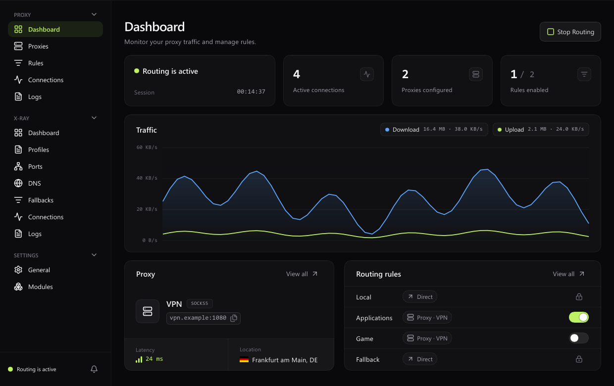

# True Proxy

**Русский** · [English](README.en.md)

Маршрутизация TCP и UDP отдельных приложений через SOCKS5 на Windows. Направьте браузер, игру и рабочие программы через разные прокси и управляйте маршрутами из одного окна.

**[Скачать для Windows x64](https://github.com/duoxik/true-proxy/releases/latest)** · [Что нового](RELEASE_NOTES.md) · [Руководство](docs/guide.md)

*Демо: адрес прокси, локация и трафик заданы для примера.*

## Быстрый старт

1. Скачайте `TrueProxy-windows-x64.zip`, распакуйте архив и запустите `TrueProxy.exe`. Windows запросит права администратора для перехвата трафика.
2. В **Proxy → Proxies** добавьте SOCKS5-сервер и проверьте его кнопкой **Test**. Для UDP серверу нужна поддержка `UDP ASSOCIATE`.
3. В **Proxy → Rules** создайте правило, выберите приложение и нужный прокси. Проверьте **Fallback** — маршрут для трафика, который не совпал ни с одним правилом.
4. На **Dashboard** нажмите **Start Routing**, если маршрутизация на паузе. Крестик окна оставляет приложение в трее. **Exit** в меню трея останавливает перехват.

При изменении правил во время работы кнопка **Restart** применяет настройки и завершает текущие прокси-соединения.

## Вкладки

### Proxy

| Вкладка | Что здесь |
| --- | --- |
| **Dashboard** | Переключатель маршрутизации, таймер сессии, скорость и график трафика. |
| **Proxies** | SOCKS5-серверы, учётные данные, проверка доступности и задержки. |
| **Rules** | Порядок правил и действия Proxy, Direct или Block для процессов, доменов, IP, портов и протоколов. |
|  **Connections** | Соединения по приложениям, маршруты, объёмы трафика и фильтры. [Подробнее](docs/guide.md#соединения). |
| **Logs** | Технический журнал с паузой, очисткой и копированием. |

### Дополнительный модуль X-Ray

После установки **Xray-core** в **Settings → Modules** в боковой панели появится раздел **X-RAY**. Модуль запускает локальные SOCKS5-порты для VLESS-профилей. Чтобы использовать порт в правилах True Proxy, добавьте его в **Proxies**. [Настройка X-Ray](docs/guide.md#дополнительный-модуль-x-ray).

| Вкладка | Что здесь |
| --- | --- |
| **Dashboard** | Запуск ядра, состояние, события и локальные SOCKS5-порты. |
| **Profiles** | Импорт VLESS и подписок, выбор активного профиля для каждого порта. |
| **Ports** | Имена и номера локальных SOCKS5-портов. |
| **DNS** | DNS для доменных запросов к портам Xray и адреса серверов VLESS. |
| **Fallbacks** | Правила прямого выхода по GeoIP и GeoSite. |
| **Connections** | События запросов, принятых Xray-core. |
| **Logs** | Отдельный технический журнал Xray-core. |

### Settings

| Вкладка | Что здесь |
| --- | --- |
| **General** | Импорт и экспорт конфигурации, тема, эффекты интерфейса, автозапуск и обновления приложения. |
| **Modules** | Установка и обновление Xray-core и hpwnr для зашифрованных подписок. |

## Что важно знать

- **Маршрутизация.** Локальные сети идут напрямую. Для остального трафика действует первое совпавшее правило, затем **Fallback**. Доменные правила зависят от наблюдаемых ответов DNS.
- **DNS.** Обычные DNS-запросы разрешает Windows. DoH и DoT следуют правилам приложения.
- **Конфигурация.** Windows защищает SOCKS5-пароли в локальном профиле. Экспорт в JSON включает их в открытом виде.
- **Статус.** Перехват WinDivert экспериментальный. Сквозные проверки TCP, UDP, IPv6 и совместимости с VPN ещё нужны. [Подробные ограничения](docs/guide.md#ограничения).

## Разработка и проверка

Rust · Slint · WinDivert. Для локальной сборки используйте `scripts/bootstrap.ps1` и `scripts/dev.ps1`. [Команды сборки и проверки](docs/guide.md#разработка-и-проверка).

[Лицензии сторонних компонентов](THIRD_PARTY_NOTICES.md)
