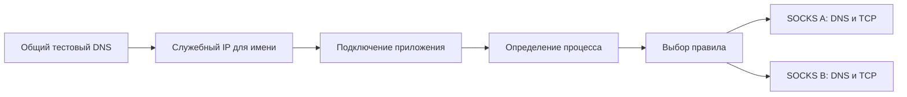

# Архив исследования DNS по приложениям

С 24 октября 2026 года исследование отложено по решению пользователя. В продукте используется системный DNS Windows; Fake-IP не включён. Описание ниже сохранено как история прототипа и не является текущим планом реализации.

# DNS по приложениям: исследование без внедрения

Решение пользователя от 24 октября 2026 года: искать механизм без внедрения
в приложения, включая игры. Вспомогательные DLL, API hooks и подмена DNS API
в сторонних процессах исключены. Производственная реализация избирательного
системного DNS пока не добавлена; исследовательский прототип описан ниже.

## Требуемый результат

Приложение, выбранное для SOCKS-маршрута, разрешает свои DNS-имена через тот же
SOCKS. Это должно включать обращения к системному резолверу Windows. Для разных
приложений и разных SOCKS один домен может давать разные ответы. Разрешение
через локальный DNS после отказа SOCKS не допускается.

Общий DNS всей системы остается отдельным режимом. Он не удовлетворяет этому
требованию: пакет от DNS Client может принадлежать общей службе, а не процессу,
который первоначально запросил имя.

## Состояние имеющейся реализации

`src/rules.rs::resolve` выбирает DNS-маршрут по владельцу сетевого потока.
Для собственных UDP/TCP DNS-запросов приложения это дает его процесс. Для
обращения через общую службу Windows — только процесс службы. Нынешний
DNS-переключатель может направлять такие общие запросы в один SOCKS.

Включенная политика DNS у совпавшего Proxy-правила использует его SOCKS.
При этом условия правила проверяются против DNS-пакета, поэтому, например,
ограничение TCP-портом 443 не подходит к DNS по UDP/53. Это также необходимо
учесть в новом механизме, а не просто изменить подпись переключателя.

## Подтвержденный эксперимент на Windows 11

`DnsSetApplicationSettings` позволяет задать DNS-серверы вызывающего процесса
и флаг `DNS_APP_SETTINGS_EXCLUSIVE_SERVERS`, запрещающий использование
системных серверов. API доступен начиная с Windows build 22000.

Изолированный процесс PowerShell/.NET на текущей Windows build 26200 успешно
выполнил `System.Net.Dns.GetHostAddresses` для случайного имени в `.invalid`
через собственный тестовый сервер `127.77.53.1:53`. Сервер вернул
`192.0.2.123`; тест получил этот адрес. WinDivert не открывался, настройки
сетевых адаптеров и чужие процессы не изменялись.

Повторная проверка в том же процессе переключила сервер на `127.77.53.2:53`
и запросила то же имя. При TTL ответа 300 секунд второй сервер получил запрос,
а результат изменился на `192.0.2.124` без очистки системного DNS-кэша. Это
подтверждает разделение этих двух конфигураций в данном тесте; проверка двух
независимых процессов и реальных SOCKS-маршрутов еще не выполнена.

В `DNS_CUSTOM_SERVER` порт адреса должен быть нулевым; сервер принимает запросы
на 53. Попытки передать явный порт в этом эксперименте возвращали код 87.
Это наблюдение текущей системы, а не дополнительная гарантия документации.

Это подтверждает возможность отдельного резолвера внутри одного процесса.
Оно пока не доказывает автоматическую работу со сторонними приложениями,
изоляцию кэша между двумя процессами, обработку всех DNS API или совместимость
с играми и защитными механизмами Windows.

## Ограничение для автоматической интеграции

У `DnsSetApplicationSettings` нет аргумента PID или пути другого приложения:
его нужно вызывать внутри соответствующего процесса. Один возможный механизм —
вспомогательная DLL и локальный DNS relay, закрепленный за маршрутом приложения.
Пользователь исключил этот механизм. Bungie прямо указывает, что Destiny 2
противодействует внедрению кода в игровой процесс; этот путь нельзя считать
универсальным.

Перехват всего DNS на уровне WinDivert, сопоставление ETW-событий по времени
или один общий список «домен → процесс» не являются доказательством точной
привязки. Одно имя может одновременно запрашиваться разными приложениями,
а системный запрос может обслуживаться общим кэшем.

## Сравнение механизмов после выбора без внедрения

| Механизм | Что дает | Что остается нерешенным | Вывод |
| --- | --- | --- | --- |
| WinDivert или TUN на уровне пакетов | Перехват UDP/TCP DNS и соединений | Пакет общей DNS-службы не содержит исходного приложения | Замена пакетного движка сама по себе недостаточна |
| WFP ALE | Приложение, пользователь и адрес соединения; перенаправление соединений | DNS через общую службу уже отделен от приложения | Полезен для сетевого слоя, но не доказан как самостоятельное решение DNS |
| WFP Name Resolution Cache | Запрос недавно разрешенных имен, условия по приложению и имени | Это не документированный API замены ответа конкретному вызову резолвера | Подходит для дополнительной информации об именах |
| DNS Client ETW | События вызовов, имен и завершений; у новых версий событий есть ClientPID | Наблюдение не блокирует вызов и не дает автоматически отдельный ответ каждому клиенту общей службы | Диагностика и атрибуция, не основание для обещания полного DNS по процессам |
| Fake-IP и разрешение при соединении | Имя восстанавливается из служебного IP, процесс известен при соединении, DNS отправляется через выбранный SOCKS | Не произвольный DNS: есть ограничения для метаданных, отсутствующих соединений, кэша и правил | Основной кандидат для следующего сетевого прототипа |

Документация Microsoft описывает Name Resolution Cache как возможность
запрашивать недавно разрешенные имена; ALE Connect Redirect меняет адрес/порт
соединения. Поэтому из наличия этих слоев нельзя делать вывод, что новый WFP
драйвер сам обеспечит требуемое разрешение имен для разных SOCKS.

### Проверка схем ETW на текущей Windows

Прочитаны только метаданные провайдера `Microsoft-Windows-DNS-Client` на Windows
build 26200. Сеанс трассировки не запускался, события пользовательских DNS-запросов
не собирались, журналы не включались.

Подтверждены, в частности:

- 3006 v0: QueryName, QueryType, QueryOptions и параметры вызова.
- 3010 v1: QueryName, QueryType, DnsServerIpAddress, ClientPID.
- 3016 v2 и 3019 v2: ClientPID и QueryBlob.
- 3023 v0: OperationName, Name, Flag, ClientPID.

Снимок схем: [dns-client-schema-26200.json](research/dns-client-schema-26200.json).
Это уточняет прежнюю оценку: сведения об исходном клиенте в ETW существуют.
Непроверенным остается надежное управление ответом общей службы, а не само
наличие PID в диагностике. В частности, сопоставление с сетевым пакетом лишь по
имени и близости времени не доказывает изоляцию при параллельных запросах.

## Локальный прототип Fake-IP

Исходники — `examples/dns-routing/`, запуск:

```powershell
.\scripts\dev.ps1 dns-probe
```

Новых зависимостей нет. Прототип не входит в продуктовый EXE. Он использует
два собственных дочерних EXE с разными именами и один случайный домен `.invalid`.
Оба клиента вызывают обычный резолвер Windows через `ToSocketAddrs` и получают
одинаковый служебный адрес `127.77.54.1`. Для безопасного локального опыта это
loopback; распределять или перехватывать реальные адреса `198.18.0.0/15` на хосте
не требуется.

Чтобы направить только тестовые запросы к тестовому DNS, каждый собственный
клиент задает свой DNS через API Windows 11 и сохраняет прежние настройки для
возврата. Код в сторонние процессы не внедряется. Это подготовка стенда, а не
предлагаемый способ подключения пользовательских приложений к будущему режиму.

При TCP-подключении стенд действительно определяет PID и путь через существующий
`process::identify`, применяет настоящие правила `rules::resolve` и вызывает
существующие `dns::exchange`, `socks::connect` и `transfer::relay`:



Результат опыта:

| Процесс | Адрес после Windows DNS | SOCKS по правилу | Ответ DNS внутри SOCKS | Ответ приложению |
| --- | --- | --- | --- | --- |
| dns-probe-a.exe | 127.77.54.1 | socks-a | 192.0.2.11 | via-A:client-a |
| dns-probe-b.exe | 127.77.54.1 | socks-b | 192.0.2.22 | via-B:client-b |

Оба mock SOCKS получили ровно один DNS-запрос; настоящая резолюция не начиналась
до определения процесса. Стенд не открывает upstream-соединений: все реальные
сокеты работают на loopback. Документационные IP 192.0.2.x передаются только
внутри mock SOCKS. Сырые результаты: [dns-route-probe.json](research/dns-route-probe.json).

**Проверено:** два реальных Windows-процесса, обычный вызов резолвера, один домен
и служебный IP, выбор разных прокси, DNS по TCP внутри SOCKS, передача полезной
нагрузки через тот же выбранный SOCKS.

**Не проверено:** системный перехват, WinDivert/TUN/WFP в этом режиме, UDP и IPv6,
невыбранные приложения с прямым маршрутом, отказы SOCKS в отложенном режиме,
сохранение адресов между запусками, игры, античит и реальные VPN.

### Почему это еще не все DNS-запросы

Fake-IP откладывает получение настоящего адреса до подключения. Это полезно
для A/AAAA, которые затем используются в соединении. Но запрос TXT или SRV
может вообще не привести к подключению; в таком случае этапа с известным
процессом не появится. Одному общему ответу Windows также нельзя автоматически
приписать сразу два разных ответа для двух SOCKS. Для полного требования
«любые DNS-запросы каждого приложения» этот вопрос остается открытым.

Дополнительные ограничения, обязательные до интеграции:

- Внедрение исключено, но это не доказывает совместимость с конкретным античитом.
  Сетевой драйвер и влияние служебных IP проверяются отдельно.
- Через общий системный DNS Fake-IP меняет видимые A/AAAA-ответы также для
  невыбранных приложений. Их будущие соединения надо возвращать на прямой
  маршрут с реальной резолюцией, а не молча отправлять через общий SOCKS.
- После выхода приложения или потери таблицы в чужих кэшах могут остаться
  служебные IP. Нужны сохраняемые соответствия и политика устаревания; нельзя
  повторно выдать старый адрес другому имени или отправить его напрямую в сеть.
- Правила по IP/CIDR не должны сравнивать служебный IP с настоящим адресом.
  Надо явно определить DNS-маршрут до проверки условий по реальному IP.
- SRV/TXT, HTTPS/SVCB, DNSSEC и DNS без последующего соединения нельзя незаметно
  переводить на локальный или общий DNS и при этом обещать DNS по приложениям.
- Самостоятельный DoH/DoT приложения остается его TCP/UDP-трафиком. Изменение
  стандартного DNS не дает возможности читать или переназначать шифрованные
  вопросы. Системный DoH тоже требует отдельной политики перехвата.

## Рекомендация

Продолжать с отдельным экспериментальным Fake-IP режимом на Rust с сохранением
текущего WinDivert для перехвата. Исследование не дает основания немедленно
заменять весь backend, писать новый драйвер или встраивать внешний Go-движок.
При реализации сначала нужны UDP/IPv6, прямые приложения, остановка и кэш в
изолированном Windows-стенде. До этого переключатель полного DNS по приложениям
в UI не добавлять и текущий системный DNS не менять.

Узкий результат исследования положительный: выбор DNS-прокси при подключении
работает без внедрения в клиент. Полное требование о любых DNS-запросах,
включая запросы без подключения и метаданные DNS, пока не решено.

## Обязательная проверка выбранной реализации

- Два процесса запрашивают одно имя через разные SOCKS и получают разные ответы.
- DNS обычного приложения, не выбранного для Proxy, сохраняет свой маршрут.
- Системные синхронные и асинхронные DNS API, собственные UDP/TCP DNS приложения.
- A/AAAA и другие используемые типы записей; усечение ответа и повтор по TCP.
- Отказ и таймаут SOCKS без локального fallback.
- Запуск нового выбранного процесса, перезапуск и повторное использование PID.
- Включение, пауза, выход, очистка ресурсов и возврат прежнего состояния.
- Неподдерживаемый процесс явно отмечается; статус не обещает защищенный DNS.

## Источники

- [Microsoft: DnsSetApplicationSettings](https://learn.microsoft.com/en-us/windows/win32/api/windns/nf-windns-dnssetapplicationsettings)
- [Microsoft: DNS_APPLICATION_SETTINGS](https://learn.microsoft.com/en-us/windows/win32/api/windns/ns-windns-dns_application_settings)
- [Microsoft: DNS_CUSTOM_SERVER](https://learn.microsoft.com/en-us/windows/win32/api/windnsdef/ns-windnsdef-dns_custom_server)
- [Microsoft: DNS Client service и кэш](https://learn.microsoft.com/en-us/windows-server/networking/dns/queries-lookups)
- [Microsoft: слои WFP](https://learn.microsoft.com/en-us/windows/win32/fwp/management-filtering-layer-identifiers-)
- [Microsoft: условия слоев WFP](https://learn.microsoft.com/en-us/windows/win32/fwp/filtering-conditions-available-at-each-filtering-layer)
- [Safing: атрибуция DNS в Windows и выбор на этапе соединения](https://safing.io/blog/2021/03/23/attributing-dns-requests-on-windows/)
- [sing-box: Fake-IP](https://sing-box.sagernet.org/configuration/dns/server/fakeip/)
- [Bungie: совместимость сторонних приложений с Destiny 2](https://help.bungie.net/hc/en-us/articles/360049199891-Destiny-2-PC-and-Third-Party-Application-Feature-Compatibility)
